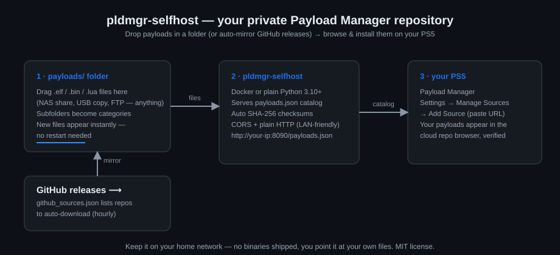

# pldmgr-selfhost

**Self-hosted private payload repository for [PS5 Payload Manager](https://github.com/itsPLK/ps5-payload-manager).**



Run your own "cloud repository" source on your home network: drop payload files into a folder
(or let it auto-mirror GitHub releases), and they show up in Payload Manager's
cloud repo browser on your console — searchable, categorized, and SHA-256 verified.

This project ships **no payload binaries** and hosts none by default. It is a
content-agnostic file server + catalog generator; you point it at your own files.
Upstream payloads remain the property of their respective authors.

## The 3-step setup (if you have Docker)

1. **Start the server** — copy this into a terminal on any always-on computer
   (a Raspberry Pi, NAS, home server, whatever runs Docker):

   ```bash
   mkdir ps5-repo && cd ps5-repo
   curl -O https://raw.githubusercontent.com/Bryanmoon19/pldmgr-selfhost/main/docker-compose.yml
   sed -i 's|^    build: .*||; s|^    # image: \(.*\)$|    image: \1|' docker-compose.yml
   mkdir payloads
   docker compose up -d
   ```

   (That switches the compose file to the ready-made image — no build needed.
   Prefer to build it yourself? `git clone` the repo instead of the curl line.)

2. **Put payloads in the folder** — drag `.elf` / `.bin` / `.lua` files into
   the `payloads` folder (FTP them over, browse to it over the network, whatever
   is easiest — subfolders are fine too).

3. **Add it on your PS5** — open **Payload Manager** → **Settings** →
   **Manage Sources** → **Add Source**, and paste:

   ```
   http://<the-computer's-ip>:8090/payloads.json
   ```

   Done. Your folder is now a catalog on your console, next to the official one.

> 💡 Find the computer's IP with `hostname -I` (Linux) or check your router's
> device list. The server prints its address on startup too.

## No Docker? 

```bash
python3 repo_server.py 8090
```

Requires Python 3.10+, no other dependencies (standard library only).

## Features

- 📂 **Drop folder** — any `.elf` / `.bin` / `.lua` placed in `payloads/`
  (subfolders allowed) appears in the catalog instantly. No restart, no rebuild.
- 🔐 **Automatic SHA-256 checksums** — every catalog entry is checksummed, so
  Payload Manager validates downloads on-console.
- 🐙 **GitHub auto-mirror** — list repos in `github_sources.json` and the latest
  matching release assets are downloaded automatically (hourly, or `POST /refresh`).
- 🌐 **CORS-ready, plain HTTP** — works around the on-console SSL verification
  quirks; ideal for home-network use.
- 🪶 **Zero dependencies** — single Python file, stdlib only.

## Keeping it updated

The Docker image is published to GitHub Container Registry on every release.
It's a multi-arch image (`linux/amd64` **and** `linux/arm64`) — Docker
auto-picks the right one, so the same pull command works on a Raspberry Pi.
To update:

```bash
docker compose pull && docker compose up -d
```

Check what version you're running: `curl http://<ip>:8090/version`
(the catalog responses also carry an `X-Server-Version` header).

## Configuration

All optional — defaults work out of the box.

| Setting | Default | Purpose |
|---|---|---|
| `PAYLOAD_DIR` env | `./payloads` | Folder scanned for payload files (point at a NAS share) |
| `REPO_NAME` env | `My Private Payloads` | Catalog name shown in Payload Manager |
| `GH_REFRESH_SECONDS` env | `3600` | How often to check GitHub for new releases |
| `github_sources.json` | empty | List of GitHub repos to auto-mirror |

### GitHub auto-mirror (`github_sources.json`)

Want new payloads to appear automatically when their developers publish a
release? List the GitHub repos:

```json
[
  {
    "repo": "ps5-payload-dev/ftpsrv",
    "include": "\\.elf$",
    "tag": "latest"
  }
]
```

- `include` — a pattern matched against release asset names (default `\.elf$`)
- `tag` — `latest` (default) or a specific release tag

Mirrored files land in `payloads/github/<owner>__<repo>/` under the
**GitHub Mirror** category. To check for updates right away:

```bash
curl -X POST http://<ip>:8090/refresh
```

## Security notes

- **Keep it on your home network.** Do NOT port-forward this to the internet —
  anyone who can reach the catalog can make your console run those payloads.
- The server is **unauthenticated** by design (Payload Manager sends no
  credentials) — that's fine on a trusted LAN, unsafe on the public internet.
- If you ever must expose it beyond home, put it behind a reverse proxy with
  authentication and only open the JSON + download routes.

## Troubleshooting

**Payload Manager can't reach the source** → first check the server is up and
copy the *exact* URL it prints on startup (it prints every LAN address it has).
Then check the PS5 and the server are on the **same network** — guest Wi-Fi and
some "IoT" Wi-Fi networks have *AP isolation* turned on, which blocks devices
from talking to each other even on the same router. Put both on your normal
home network.

**The source worked before, now it doesn't** → the server's IP address
probably changed (that's what DHCP does). Two fixes: give the server box a
**static IP / DHCP reservation** in your router settings (recommended, one-time),
then update the URL in Payload Manager.

**Downloads from the catalog fail but the catalog loads** → pldmgr is showing
its cached copy of the catalog while the server is down or unreachable. Restart
the server (`docker compose up -d`), then refresh the repository in Payload
Manager.

**I dropped a file in but it doesn't show up** → check the extension is exactly
`.elf`, `.bin`, or `.lua` (files starting with a dot are ignored), and that it's
inside the `payloads` folder (or a subfolder of it). The catalog is rebuilt on
every request — just refresh the repository view in Payload Manager.

**Is the server actually running?** → open `http://<ip>:8090/version` in any
browser on your network. If you get `{"version": "0.1.0"}` back, it's alive.

## FAQ

**Does the PS5 need to be detected / paired with the server?**
No. The PS5 *pulls* from the server — the server never talks to the console
first. The only setup is pasting one URL into Payload Manager once. Nothing
scans your network.

**Is there a refresh button?**
Effectively, always-on: the catalog is rebuilt every single time it's fetched,
so new files appear the next time Payload Manager looks at the repository.
For the GitHub auto-mirror, releases are checked hourly, or you can force a
check instantly: `curl -X POST http://<ip>:8090/refresh`.

**Can I run this on a Raspberry Pi / NAS / Synology?**
Yes — anything that runs Docker or Python 3.10+. A Pi Zero is more than
enough; the server is a single small Python file.

**Can I run it on the same machine as my other home-server stuff?**
Yes. It's one small container listening on port 8090. If that port is taken,
change the left side of the ports line in `docker-compose.yml`
(e.g. `"8190:8090"` → then your URL uses port 8190).

**Does the server store anything on my PS5 / change my console?**
No. It's read-only from the console's perspective: Payload Manager downloads
files exactly like it does from the official cloud repository, with the same
SHA-256 verification. Installing/running payloads behaves identically.

**Can I have more than one person/console use it?**
Yes — any console (or web dashboard) on the same network can add the same URL.
Each console keeps its own downloaded files.

**Is my collection sent anywhere?**
No. Everything stays on your network. The only outbound traffic is the optional
GitHub auto-mirror checking for new releases of repos *you* listed.

**Why plain HTTP and not HTTPS?**
Two reasons: Payload Manager has known SSL certificate validation quirks on
console, and this is designed for a trusted home LAN. If you expose it beyond
your LAN, you should add a reverse proxy with HTTPS + auth — but really,
don't expose it beyond your LAN.

**Can I share my repository with a friend over the internet?**
Not with this alone, and you shouldn't port-forward it. If a friend wants a
private repo, the right answer is: they run their own instance (it takes 3
steps — see above). That's the whole point of it being self-hosted.

**Does it work with the official repository at the same time?**
Yes — custom sources appear *alongside* the official one in Payload Manager.
Adding this doesn't replace or modify anything.

**How do I update to a new version?**
`docker compose pull && docker compose up -d` (or `git pull` if running bare
metal). Check what you're running any time with `curl http://<ip>:8090/version`.
See [CHANGELOG.md](CHANGELOG.md) for what changed.

**I got a checksum mismatch warning. What does that mean?**
The file changed between the catalog listing and the download — usually
because you replaced the file while the console was mid-download. Re-download
it (the catalog is rebuilt each request, so the checksum is fresh).

## Found a problem or have an idea?

Open an issue — the templates ask a few quick questions (your version, what
happened, what you expected). For the version, `curl http://<ip>:8090/version`
gives you the answer to paste in.

## Catalog format

The generated `payloads.json` follows Payload Manager's
[CUSTOM_REPOSITORIES.md](https://github.com/itsPLK/ps5-payload-manager/blob/main/CUSTOM_REPOSITORIES.md)
spec (top-level `name` before `payloads`, SHA-256 `checksum` per item).

## Changelog

See [CHANGELOG.md](CHANGELOG.md) — versions follow [Semantic Versioning](https://semver.org/).

## License

MIT — see [LICENSE](LICENSE). This project is not affiliated with itsPLK or
the Payload Manager project; it simply implements their public custom-source spec.

## Credits

- [itsPLK/ps5-payload-manager](https://github.com/itsPLK/ps5-payload-manager) — the manager and its custom repository spec
- [lucaszhongsj/ps5-payloads-atlas](https://github.com/lucaszhongsj/ps5-payloads-atlas) — the public-catalog cousin of this private-server idea